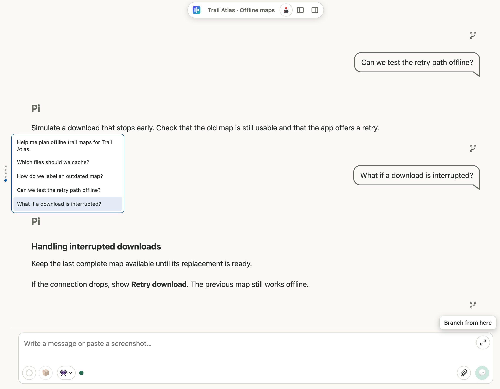

# Pi Chat

Pi Chat is a local browser interface for the [Pi coding agent](https://pi.dev/).
Keep Pi running in your terminal, and use the browser to chat, ask follow-up
questions about specific passages in a reply, and find sessions across projects.

## Install

You’ll need Pi 1.3.0 and Node.js 22.19 or newer. There’s no build step.

```sh
git clone https://github.com/TongVu/pi-chat.git
cd pi-chat
npm ci --omit=dev --ignore-scripts --legacy-peer-deps
pi install "$PWD"
```

To open the **dashboard**, run `pi --dashboard` from the project you want to work
in. To open **browser chat** for a Pi session you already have running, type
`/chat` in that session. If it was running before you installed the extension,
run `/reload` first. Keep the Pi terminal open while you use the browser.

## What you can do

The screenshots below use fictional projects and conversations.

### Find chats by project

Filter sessions by status, bookmark chats, and reopen or resume them from the
Dashboard. Pixel pets reflect each session’s status: they type while Pi works,
celebrate when it’s ready, and doze when the chat is disconnected and idle.


### Find an earlier prompt and branch from a reply

Hover over the message dots to preview the prompts you sent. Click a dot or a
prompt in the list to jump back to it. Use **Branch from here** beneath a reply
to start a named subchat with the conversation up to that point, leaving the
original chat unchanged.



### Chat in the browser and ask about a passage

Read Markdown replies and code blocks, and send screenshots or text files.
Label fenced code blocks `js`, `java`, `bash` (or `shell`), or `diff` to highlight them.
To ask about a specific passage, select it and click **Add annotation**. You can
send several questions together, each with its quote. Keep a checklist or other
reference material in the **Markdown note**, which saves locally without
sending it to Pi.

On desktop, drag the inner edge of either side panel to resize it, or focus
its divider and use the left and right arrow keys. Widths survive a page refresh.


## More details

The browser connects to Pi on your own machine. Messages you send still go
through the model provider configured in Pi. Don’t share the local chat link.

See the [Pi Chat guide](docs/guide.md) for usage, platform differences, privacy,
and development checks. For an Ubuntu desktop, follow [Set up Pi Chat with Edge
and Kitty](docs/ubuntu-edge-kitty.md), including a prompt for the setup agent.
