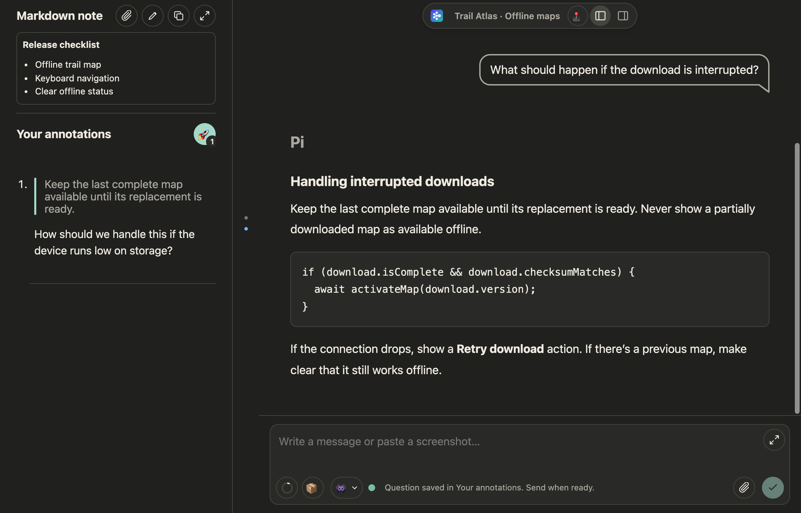
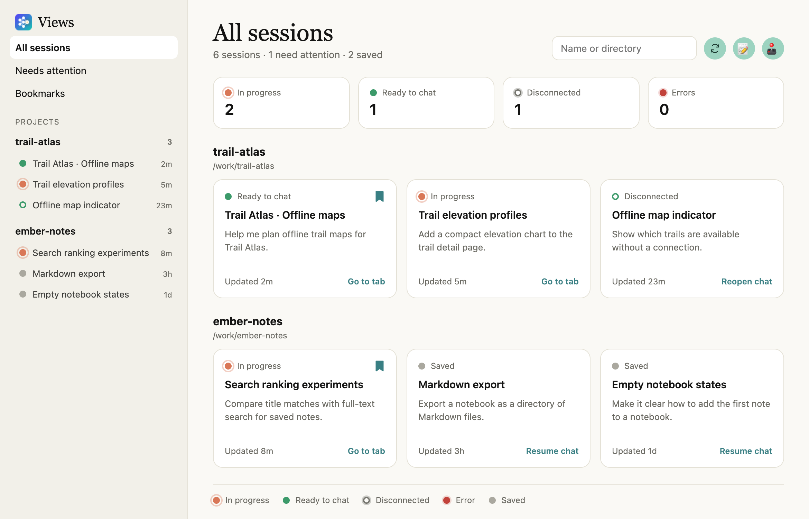

# Pi Chat

Pi Chat is a local browser interface for the [Pi coding agent](https://pi.dev/).
Keep Pi running in your terminal, and use the browser to chat, ask follow-up
questions about specific passages in a reply, and find sessions across projects.

## Install

You’ll need Pi 1.3.0 and Node.js 22.19 or newer. There’s no build step.

```sh
git clone https://github.com/TongVu/pi-chat.git
cd pi-chat
npm ci --omit=dev --ignore-scripts --legacy-peer-deps
pi install "$PWD"
```

To open the **dashboard**, run `pi --dashboard` from the project you want to work
in. To open **browser chat** for a Pi session you already have running, type
`/chat` in that session. If it was running before you installed the extension,
run `/reload` first. Keep the Pi terminal open while you use the browser.

## What you can do

The screenshots below use fictional projects and conversations.

### Chat in the browser and ask about a passage

Read Markdown replies and code blocks, jump between turns, and send screenshots
or text files. To ask about a specific passage, select it and click **Add
annotation**. You can send several questions together, each with its quote. Keep
a checklist or other reference material in the **Markdown note**, which saves
locally without sending it to Pi.



### Find chats by project

Use the dashboard to find saved sessions, bookmark chats you want to return to,
and see which connected chats are working or ready for another message.



## More details

The browser connects to Pi on your own machine. Messages you send still go
through the model provider configured in Pi. Don’t share the local chat link.

See the [Pi Chat guide](docs/guide.md) for usage, platform differences, privacy,
and development checks.
